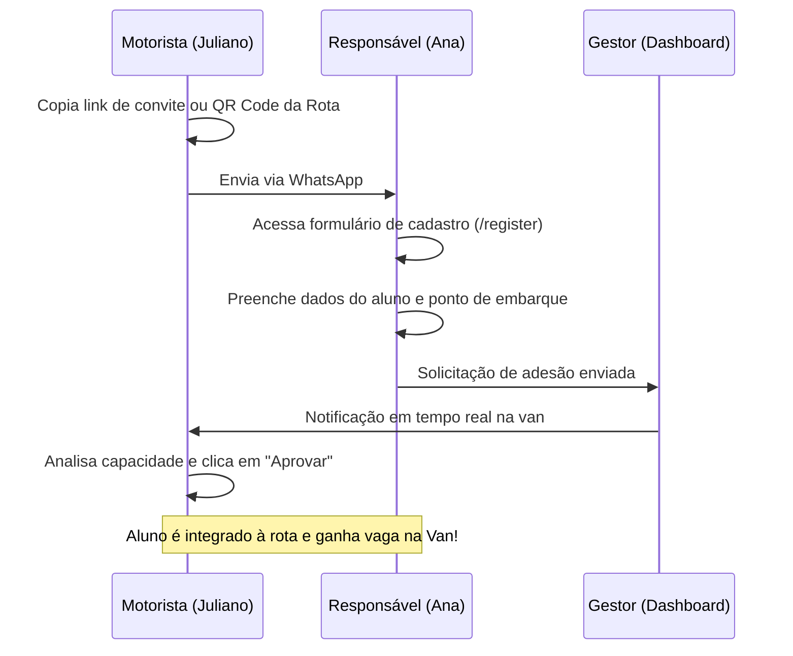

# 🛡️ Guia de Validação de Fluxos — Guardian

Este guia serve como roteiro oficial para homologação e testes práticos com usuários finais (motoristas, pais de alunos e monitores). O Guardian foi projetado de forma híbrida: você pode simular cenários inteiros usando o ambiente de **Homologação (Banco Mock)** ou rodar testes reais com dados integrados ao **Firestore de Produção**.

---

## 🗺️ Visão Geral do Sistema e Ambientes

O comportamento de armazenamento de dados e autenticação é controlado de forma centralizada pela variável de ambiente `NEXT_PUBLIC_DATA_MODE`:

| Modo | Fonte de Dados | Autenticação | Objetivo Principal |
| :--- | :--- | :--- | :--- |
| **Homologação (`mock`)** | LocalStorage reativo e sementeira simulada | Credenciais padrão em `ACESSO_SIMULACAO.md` | Apresentações rápidas, testes rápidos sem custo de rede |
| **Produção (`firestore`)** | Google Firestore em tempo real | Firebase Authentication real | Uso diário com usuários finais em produção |

---

## 🚀 Matriz de Usuários e Credenciais de Teste (Modo Homologação)

Para testar todos os papéis integrados rapidamente, utilize os seguintes perfis configurados com dados simulados ricos:

| Perfil | Identificador (CPF) | PIN de Acesso | Interface de Entrada |
| :--- | :--- | :--- | :--- |
| **Gestor de Frota** | `000.000.000-01` | `1234` | `/dashboard` (Painel Administrativo) |
| **Motorista (Juliano)** | `000.000.000-02` | `1234` | `/driver` (Painel da Van/Operação) |
| **Pai/Responsável (Ana)** | `000.000.000-03` | `1234` | `/parent` (Acompanhamento Familiar) |
| **Monitor Escolar (Fernanda)**| `000.000.000-04` | `1234` | `/assistant` (Embarques e Segurança) |

---

## 🎭 Roteiros de Teste de Ponta a Ponta (User Journey)

### Cenário 1: O Convite Inteligente e Autonomia no Onboarding
*O objetivo deste fluxo é simular como um pai cadastra um filho de forma autônoma a partir de um convite da van do motorista.*

**Passo a Passo de Validação:**
1. **[Motorista]** Acesse o painel do motorista (`/driver`) e vá na aba **"Alunos"** para ver o convite rápido da rota.
2. **[Pai]** Simule o cadastro de um novo aluno acessando a página pública de registro (`/register`). Cadastre um filho de exemplo escolhendo uma escola da lista inteligente (com busca oficial INEP).
3. **[Motorista]** Retorne à tela do motorista e observe o indicador de **solicitações pendentes**. Clique para visualizar a solicitação e aprove o aluno.
4. **[Resultado Esperado]** O aluno agora aparece na lista de passageiros ativos da rota, e a capacidade de vagas da van é recalculada em tempo real.

---

### Cenário 2: A Viagem Operacional do Dia a Dia (Embarque e Rastreamento)
*Este é o fluxo mais valioso da ferramenta. Ele simula o motorista rodando a rota e o monitor controlando os embarques enquanto os pais acompanham tudo em tempo real.*

**Passo a Passo de Validação:**
1. **[Motorista]** No painel da van (`/driver`), clique em **"Iniciar Viagem"** (selecione o sentido: Ida ou Volta).
   - *Nota de Flexibilidade:* Você pode configurar um **Monitor Substituto** para a rota no seletor de topo antes de iniciar.
2. **[Monitor]** Acesse a interface do monitor (`/assistant`). Você verá a rota ativa em tempo real.
3. **[Monitor - Embarque Seguro]** À medida que a van para nos pontos, selecione o aluno e clique em **"Check-in"**:
   - Utilize a verificação visual de fotos.
   - Faça o check-in rápido.
4. **[Pai]** Acesse o portal do pai (`/parent`).
   - **Rastreamento**: Acompanhe o mapa com a localização simulada da van e o status do filho atualizado para **"A caminho"** ou **"Embarcado"**.
5. **[Monitor - Desembarque com Segurança]** Na escola (ou de volta nas residências), o monitor clica em **"Check-out"**.
   - No caso de devolução do aluno para um responsável físico, o sistema abre o modal de **Retirada Segura**, exibindo a foto, nome, parentesco e CPF dos adultos cadastrados e autorizados. Selecione quem está retirando para confirmar a entrega.
6. **[Resultado Esperado]** O pai recebe notificações de embarque/desembarque instantâneas, e o painel do gestor consolida o status operacional com segurança máxima.

---

### Cenário 3: O Fluxo de Ausência Inteligente (Economia de Combustível)
*Simula um imprevisto onde o pai avisa de última hora que o aluno não irá à escola hoje.*

**Passo a Passo de Validação:**
1. **[Pai]** No portal do pai (`/parent`), localize o card de frequência do filho e clique em **"Declarar Ausência"** (Hoje não vai).
2. **[Motorista/Monitor]** Acesse os painéis de operação da van (`/driver` e `/assistant`).
3. **[Resultado Esperado]** A parada da residência deste aluno é riscada/ocultada do itinerário operacional automaticamente. O motorista não gasta combustível parando em uma casa vazia, e a rota de navegação é recalculada dinamicamente.

---

### Cenário 4: Geração Financeira e Conciliação de Custos
*O gestor audita e gerencia o faturamento mensal e as contas operacionais.*

**Passo a Passo de Validação:**
1. **[Gestor]** No painel administrativo (`/dashboard`), acesse a seção **"Financeiro"**.
2. **[Gestor - Faturamento]** Clique no botão **"Gerar Faturas do Mês"**.
   - *Resiliência:* Se houver alunos sem mensalidade cadastrada, o sistema abrirá um painel de alerta listando os alunos com mensalidade zerada antes de prosseguir, evitando faturamentos nulos indesejados.
3. **[Pai]** Acesse o portal do pai (`/parent`) e veja que a nova fatura com status **"Pendente"** foi listada. O pai pode fazer o upload do comprovante ou simular o pagamento.
4. **[Gestor - Auditoria]** Volte ao painel do Gestor. Adicione despesas (combustível, manutenção, salários) na aba **"Despesas"**.
5. **[Resultado Esperado]** O painel do gestor exibe o balanço líquido real da frota (Receitas - Despesas), com indicadores gráficos de lucratividade.

---

## 🛡️ Varredura de Resiliência Técnica Concluída

Durante o refinamento do código, aplicamos correções cirúrgicas de blindagem para garantir que o sistema nunca quebre na frente do usuário ou em momentos de instabilidade de dados:

*   **Proteção de Splits e Nulos:** Impedimos erros clássicos de manipulação de strings na quebra de nomes próprios ou renderização de fotos. Se um usuário ou irmão for cadastrado com campos nulos, o sistema utiliza fallbacks inteligentes como `"Sem Nome"` ou `"Irmão"` em vez de travar a tela.
*   **Tratamento de Datas Malformadas:** O painel financeiro consolidava meses e faturas chamando métodos de substring diretamente sobre as datas. Blindamos os laços `forEach` e o formatador de meses para ignorar registros órfãos ou inconsistentes sem derrubar a tela.
*   **Tratamento de Erros Isolados (`ErrorBoundary`):** Adicionamos barreiras de proteção de erros em volta de seções de dados assíncronos. Se uma aba falhar por qualquer motivo de conexão externa, o restante do aplicativo continua funcionando normalmente.

---

## 💡 Dicas de Sucesso para Testar com o Usuário

1. **Use o modo de Homologação (Mock) para demonstrações rápidas:** Como ele possui sementeira rica de dados pré-carregados (Juliano, Ana, Fernanda), o usuário entende o valor do produto em 2 minutos sem precisar preencher dezenas de cadastros.
2. **Abra múltiplas abas do navegador (ou use dispositivos diferentes):** Abra o painel do motorista no seu celular e o painel do pai no celular do usuário de teste para que eles vejam a mágica da sincronização em tempo real do rastreamento!
3. **Foque na dor do usuário:** Mostre como o "Hoje não vai" economiza tempo para o motorista, e como a "Retirada Segura" dá paz de espírito para a mãe que está trabalhando e quer saber se o filho chegou bem.
