# Guardian - Manual do Usuário: Módulo do Gestor

Este manual descreve em detalhes a operação do portal administrativo do Guardian (Módulo do Gestor) no ambiente de produção. Ele serve como guia passo a passo para configurar a empresa, gerenciar ativos, planejar rotas e operar as automações financeiras de faturamento e contratos.

---

## 🔑 1. Acesso, Login e Credenciais

O acesso ao painel do Gestor é realizado através da tela de Login principal.

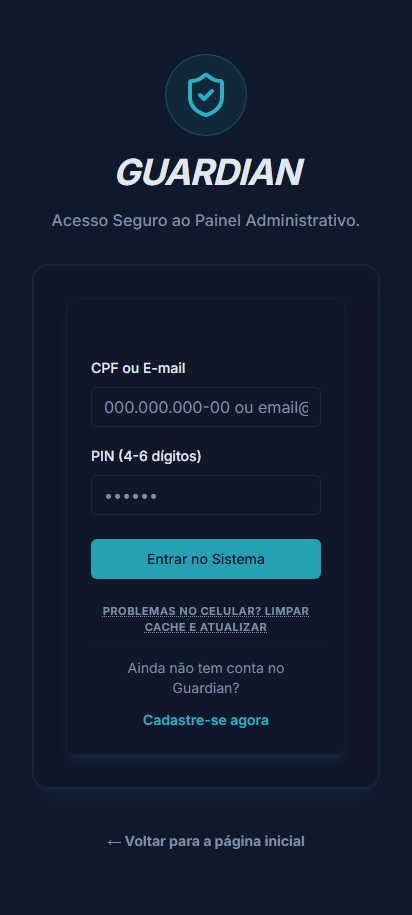

*   **Tipos de Credenciais Aceitas**:
    *   **E-mail e Senha**: Utilizado como credencial administrativa principal. O e-mail deve ser cadastrado previamente pela central.
    *   **CPF e PIN**: Permite o acesso seguro utilizando o número do CPF e o código PIN numérico (de 4 a 6 dígitos).
*   **Modo de Acesso**:
    *   Insira seu CPF ou E-mail no campo "CPF ou E-mail".
    *   Insira seu PIN ou Senha no campo correspondente.
    *   Clique em **"Entrar no Sistema"**.
*   **Resolução de Problemas (Cache & PWA)**:
    *   Caso observe inconsistências visuais, atrasos no carregamento ou falhas ao carregar em celulares e tablets, utilize o botão **"Limpar cache e atualizar"** localizado no rodapé do formulário de login. Isso forçará a limpeza de arquivos temporários do navegador e reinstalará o Service Worker do PWA com a versão mais recente da produção.

---

## ⛓️ 2. Sequência Obrigatória de Cadastros (Primeiros Passos)

Para implantar o Guardian em produção com sucesso, o Gestor **deve seguir rigorosamente a sequência de cadastros abaixo**. Devido às dependências lógicas do banco de dados (por exemplo, você não pode cadastrar um motorista sem associá-lo a um veículo pré-existente, nem associar um aluno a uma rota que ainda não foi criada), pular etapas impedirá o funcionamento da plataforma:

```
[1. Perfil da Empresa & Chave Pix]
             │
             ▼
[2. Modelo de Contrato Digital]
             │
             ▼
[3. Escolas Atendidas (Base INEP)]
             │
             ▼
[4. Frota de Veículos]
             │
             ▼
[5. Equipe: Motoristas & Monitores]
             │
             ▼
[6. Criação das Rotas Operacionais]
             │
             ▼
[7. Onboarding dos Pais & Alocação]
```

1.  **Perfil da Empresa & Chave Pix**: Defina os dados fiscais e bancários. Sem isso, as tags automáticas de cobrança e contratos falharão.
2.  **Modelos de Contrato**: Defina o texto-base com as tags de substituição automática.
3.  **Escolas**: Cadastre as unidades de ensino para habilitar os pontos de parada finais.
4.  **Frota de Veículos**: Insira as vans e capacidades para limitar a superlotação.
5.  **Motoristas e Monitores**: Cadastre a equipe associando o motorista ao veículo cadastrado na etapa 4.
6.  **Criação das Rotas**: Configure os itinerários do dia associando o veículo (etapa 4) e a equipe (etapa 5).
7.  **Onboarding de Alunos/Pais**: O pai realiza o pré-cadastro via app. O gestor aprova, o sistema cria a conta, vincula à rota (etapa 6), preenche o contrato (etapa 2) e emite a primeira cobrança (etapa 1).

---

## 📊 3. Painel de Controle e Visão Geral (Overview)

Após o login, o Gestor é direcionado para a tela principal (`/dashboard/overview`).

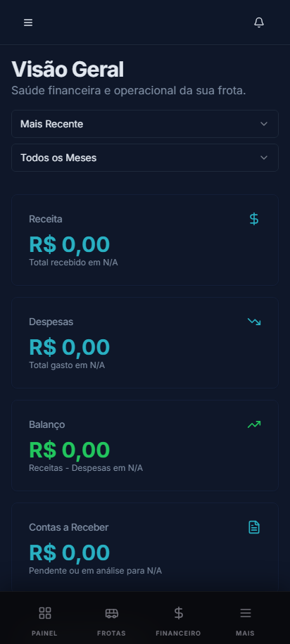

*   **KPIs Gerais (Indicadores)**:
    *   **Pontualidade**: Percentual de paradas realizadas dentro do horário previsto.
    *   **Consumo da Frota**: Média de consumo combinada de combustível.
    *   **Incidentes Ativos**: Contador de problemas em aberto no trânsito ou mecânica.
    *   **Quilometragem Economizada**: KM economizados por meio de rotas inteligentes.
*   **Mural de Incidentes**: Exibe relatos urgentes enviados pelos motoristas (ex: pneu furado, via interditada). Cada item contém o nome do motorista, horário e veículo.

    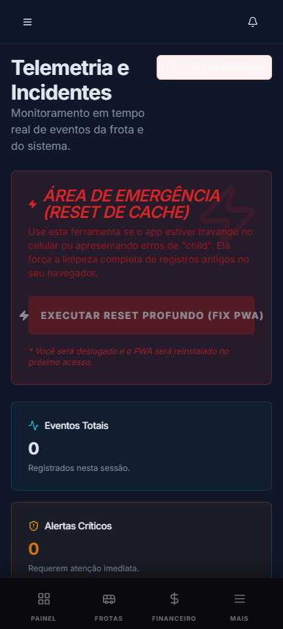
*   **Histórico e Feed Operacional (`/dashboard/operational-history`)**:
    *   Fluxo contínuo atualizado em tempo real mostrando as ações de embarque, desembarque, faltas informadas pelos pais e início/fim de viagens realizadas pela frota.

---

## 📝 4. Cadastro e Gestão de Ativos

As configurações cadastrais são controladas a partir do menu lateral de gestão (`/dashboard/management/...`).

### A. Escolas (`/schools`)

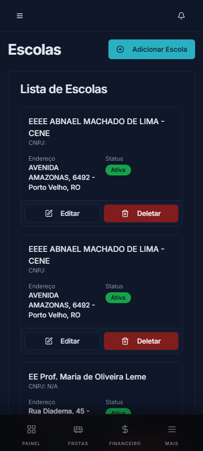

*   **Como Cadastrar**:
    *   Clique em **"Cadastrar Nova Escola"**.
    *   **Busca Nativa (Base INEP)**: Digite o nome da escola no campo de busca. O sistema está integrado nativamente com a base nacional do INEP (contendo mais de 190.000 instituições brasileiras). Ao selecionar a escola da lista, o endereço e dados cadastrais são preenchidos automaticamente.
    *   **Turnos de Atendimento**: Marque se a escola atende no turno da Manhã, Tarde ou Ambos.

### B. Veículos (`/vehicles`)

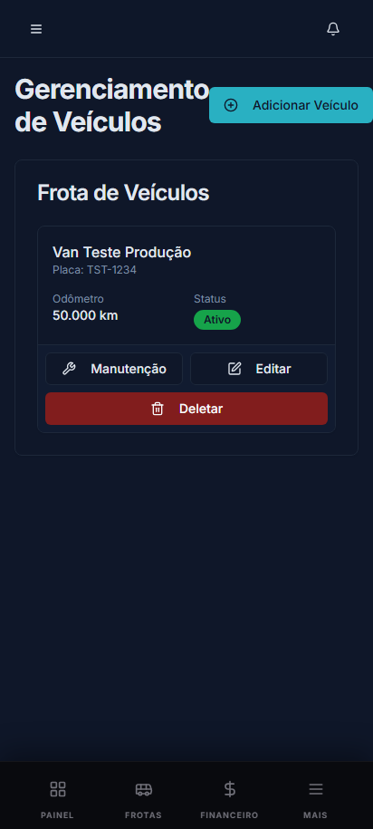

*   **Como Cadastrar e Atualizar**:
    *   Insira o Modelo do veículo, a Placa e a Capacidade máxima de passageiros sentados (para evitar superlotação de vans).
    *   **Alerta de Manutenção Preditiva**: Digite o Hodômetro atual do veículo e o intervalo padrão de manutenção (ex: a cada 10.000 km). O sistema monitora a rodagem acumulada e aciona um alerta vermelho de "Revisão Urgente" quando a quilometragem atualizada se aproxima de 1.000 km do limite.

### C. Motoristas e Monitores (`/drivers` e `/monitors`)

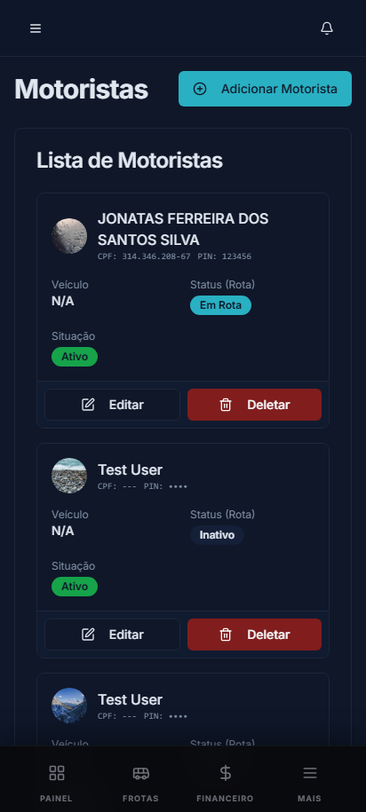
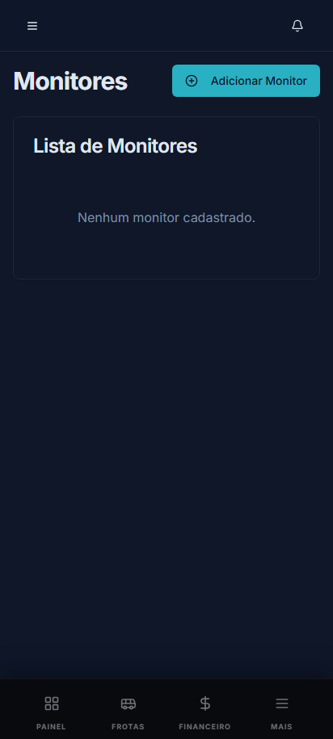

*   Insira o nome completo, CPF, telefone de contato e CNH (no caso de motoristas).
*   Associe o motorista/monitor a um veículo padrão e a uma rota ativa.

---

## ⚡ 5. Processo de Triagem e Onboarding Automático (`/pending-registrations`)

Quando um pai realiza o pré-cadastro pelo aplicativo móvel dele, os dados entram em análise no painel administrativo de Cadastros Pendentes.

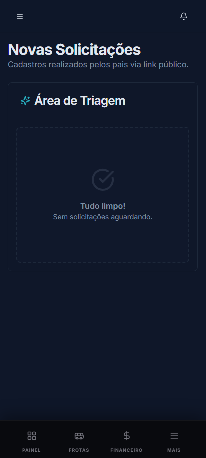

*   **Fluxo de Revisão (OCR)**:
    *   O Gestor abre a solicitação pendente e visualiza os dados extraídos automaticamente pela Inteligência Artificial (Gemini OCR) a partir da foto do documento de identidade do responsável.
    *   O Gestor deve revisar o endereço sugerido, selecionar a rota ideal para o aluno e definir o valor final acordado da mensalidade (mensalidade padrão sugerida de R$ 450,00).

*   **Lógica de Aprovação e Automação de 5 Etapas**:
    Ao clicar em **"Aprovar"**, o Guardian dispara sequencialmente as seguintes lógicas em produção:
    1.  **Criação de Conta do Pai**: O sistema verifica se o CPF/E-mail do responsável já existe. Se não existir, gera o registro de `parents` e cria um login de acesso seguro na tabela `users` com o perfil `pai` e o PIN padrão inicial (geralmente `123456` ou o PIN gerado no cadastro).
    2.  **Cadastro do Aluno & Geocodificação Automática**: Cria a ficha do aluno (`students`) e executa uma requisição de geolocalização no servidor (Geoapify) para transformar o endereço textual em coordenadas de latitude e longitude precisas, garantindo que o ponto apareça no mapa de roteirização.
    3.  **Alocação na Rota**: Vincula o aluno à rota escolhida e recalcula os tempos médios de chegada (ETA).
    4.  **Geração Automática de Contrato**: Preenche o contrato de serviço (`contracts`) com base no modelo ativo. A IA preenche tags como `{{aluno_nome}}`, `{{responsavel_nome}}`, `{{valor_mensalidade}}`, `{{dia_vencimento}}` e `{{pagamento_info}}` (chave Pix da empresa). O status do contrato é definido como `pending_acceptance`, aguardando a assinatura digital do responsável.
    5.  **Geração Automática da 1ª Fatura**: O sistema emite a primeira mensalidade (`invoices`). Se a data atual for maior do que o dia preferencial de pagamento do aluno para o mês corrente, a fatura é marcada automaticamente como vencida (`overdue`), caso contrário, permanece pendente (`pending`).

---

## 🗺️ 6. Tela de Criação de Rotas e Roteirização Dinâmica (`/routes` & `/route-planning`)

O controle de itinerários é realizado em `/dashboard/management/routes`. É nesta tela que o gestor desenha e otimiza os trajetos.

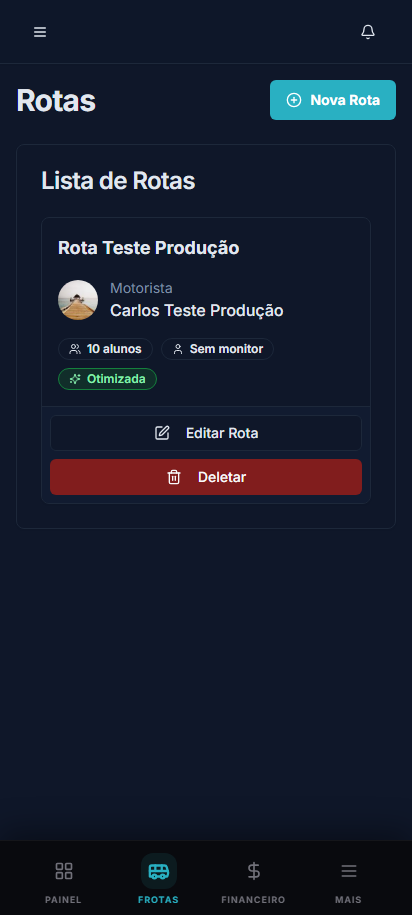

### Guia Visual da Tela de Criação de Rotas
Abaixo está o mapeamento visual do painel de configuração e otimização de itinerários:

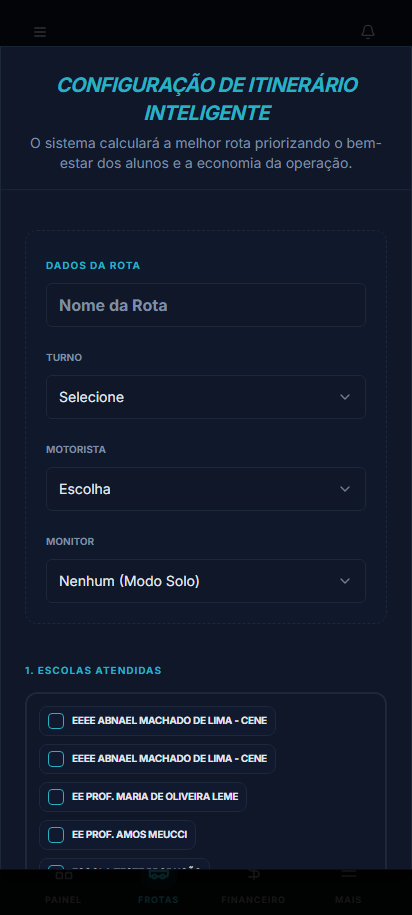

### A. Criando ou Editando uma Rota
Ao clicar no botão **"Adicionar Rota"** (ou **"Editar"** em uma rota existente), o formulário inteligente de itinerário é aberto. Preencha os campos obrigatórios:
1.  **Nome da Rota**: Nome identificador do trajeto (ex: "Rota Sul - Tarde").
2.  **Turno**: Selecione se a rota é do turno da **Manhã** ou da **Tarde**. Ao selecionar, o sistema filtra a lista de alunos disponíveis exibindo apenas aqueles cadastrados nesse turno.
3.  **Motorista**: Escolha o motorista responsável. O sistema detectará automaticamente qual veículo está atribuído a esse motorista e a capacidade máxima de assentos dele.
4.  **Monitor**: Selecione o monitor acompanhante. Se o motorista viajar sozinho, escolha **"Nenhum (Modo Solo)"**.
5.  **Escolas Atendidas**: Selecione através dos checkboxes quais escolas essa rota atende. Ao marcar as escolas, o sistema habilita os alunos matriculados nelas para seleção.

### B. Estratégia de Roteirização (Regras de Negócio)
Ao selecionar mais de uma escola para a mesma rota, o sistema exibe o painel de estratégia:
*   **Segurança Total (Regras de Ouro)**: A van deve primeiro coletar todos os alunos nas residências e só depois iniciar os desembarques nas escolas. Recomendado para maior controle de fluxo.
*   **Máxima Agilidade (Plano do Motorista)**: Permite desembarques intermediários. O sistema pode parar em uma escola no meio do percurso se todas as crianças daquela escola específica já tiverem sido recolhidas.

### C. Alocação de Alunos (Individual ou em Massa)
*   **Adicionar Aluno**: Use o campo de busca na listagem de alunos livres para localizar um aluno e clique em `+` (PlusCircle). A escola desse aluno é automaticamente adicionada ao itinerário como ponto de desembarque.
*   **Inclusão em Massa**: Clique em **"Inclusão em Massa"** para adicionar todos os alunos disponíveis do turno/escola selecionados de uma só vez.

### D. Organização e Otimização do Itinerário por IA
*   **Reordenamento Manual**: Na lista de paradas à direita, o gestor pode alterar a ordem de qualquer parada utilizando os botões de seta para cima/para baixo ou remover paradas clicando no ícone de exclusão (`X`).
*   **Otimização Inteligente**: Clique em **"OTIMIZAR ROTA"**. A Inteligência Artificial lerá as coordenadas geográficas da casa de cada aluno e das escolas e calculará o trajeto mais curto resolvendo a ordem logística ideal. Em seguida, o sistema conecta-se ao Geoapify para traçar e desenhar a linha do trajeto no mapa do motorista.

    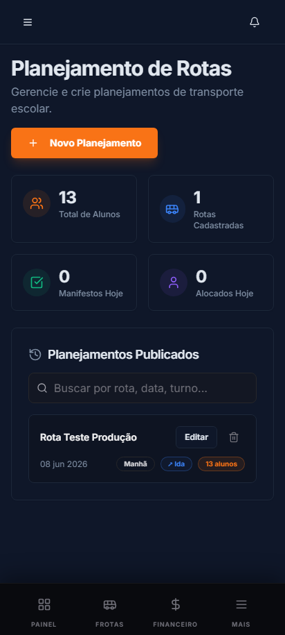
*   **Exportar para o Motorista**: Clique em **"Enviar p/ WhatsApp"** para gerar uma lista de paradas formatada textualmente (ex: `01. [ALUNO] João, 02. [ESCOLA] Escola ABC`) e abrir diretamente no WhatsApp do motorista correspondente.

### E. Autopilot Operacional e Financeiro ao Salvar a Rota
Ao clicar em **"SALVAR ROTA DEFINITIVA"**, o Guardian executa as seguintes lógicas em segundo plano:
*   **Alunos Removidos da Rota**: Se algum aluno foi excluído da lista de paradas, seu status no sistema retorna para `pendente_alocacao` e o campo de rota é desvinculado.
*   **Novos Alunos Inseridos na Rota**:
    1. O status do aluno é alterado para `aguardando` e o ID da rota é gravado em sua ficha.
    2. **Contrato Automático**: Se houver um modelo ativo de contrato cadastrado na empresa, o sistema gera e salva o contrato correspondente em PDF com o status `pending_acceptance`.
    3. **Financeiro Inicial**: O sistema gera a primeira mensalidade do aluno com base no valor de sua mensalidade configurada (`monthlyFee`) e envia para a fila de pagamentos do responsável.

---

## 💵 7. Faturamento Financeiro e Gestão de Cobrança (`/dashboard/financial`)

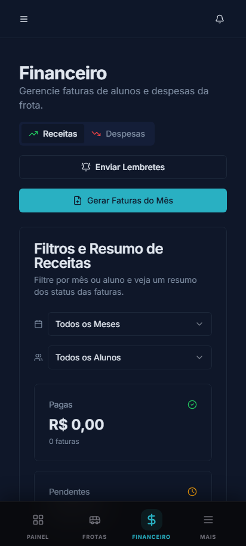

O controle financeiro opera sob regras estritas para evitar cobranças duplicadas ou furos de conciliação.

*   **Lógica de Faturamento Mensal Automático em Lote**:
    *   Na guia de Receitas, o Gestor possui o botão de **Geração de Faturas Mensais**.
    *   Ao clicar, a rotina de faturamento varre todos os alunos ativos no banco.
    *   **Verificação Antiduplicidade**: Para cada aluno, o sistema checa se já existe uma fatura gerada com o termo "Mensalidade Transporte" na competência do mês atual. Se encontrar, o aluno é ignorado para evitar dupla cobrança.
    *   **Emissão**: Se não houver fatura, gera a fatura mensal com o valor configurado na ficha do aluno (`monthlyFee`) e a data de vencimento calculada no dia preferido (`preferredPaymentDay`), com o status inicial `pending`.
*   **Conciliação Manual (Faturas "Em Análise")**:
    *   Faturas com o status `pagamento_em_analise` representam comprovantes enviados pelos pais através do app deles.
    *   O Gestor clica no menu de ações da linha correspondente, visualiza os dados/comprovante e clica em **"Marcar como Paga"** para atualizar o status para `paid` e emitir o recibo digital.
*   **Contratos Digitais (`/dashboard/management/contracts`)**:
    *   Acompanhamento em tempo real dos contratos gerados para cada aluno. O gestor pode visualizar o status de aceite de cada responsável e fazer download do PDF assinado digitalmente.

    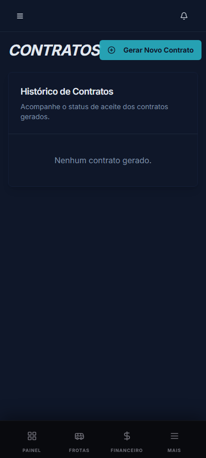

---

## 🤖 8. Assistentes e Inteligência Artificial

*   **Otimizador de Rotas IA (`/assistant/route-plan`)**:
    *   O gestor seleciona a rota de interesse. A IA lê a geolocalização dos alunos cadastrados na rota e traça o menor percurso resolvendo o problema logístico clássico do caixeiro-viajante (TSP). O resultado sugere a ordem exata de paradas por menor distância percorrida.
*   **Chat Administrativo (`/assistant/messages`)**:
    *   Interface conversacional inteligente que permite tirar dúvidas sobre a operação da plataforma, métricas da frota ou relatórios rápidos por texto.

---

## 📢 9. Comunicações Gerais

*   **Mural de Avisos (`/dashboard/management/announcements`)**:
    *   Permite disparar comunicados que aparecem no mural do aplicativo dos Pais e dos Motoristas (ex: "Sem funcionamento em feriado nacional").
*   **Mensagens Rápidas (`/dashboard/management/predefined-messages`)**:
    *   O Gestor cadastra mensagens prontas de aviso operacional (ex: "Van quebrada, veículo reserva enviado"). Essas mensagens ficam disponíveis como atalhos de clique rápido para motoristas e monitores em trânsito.
