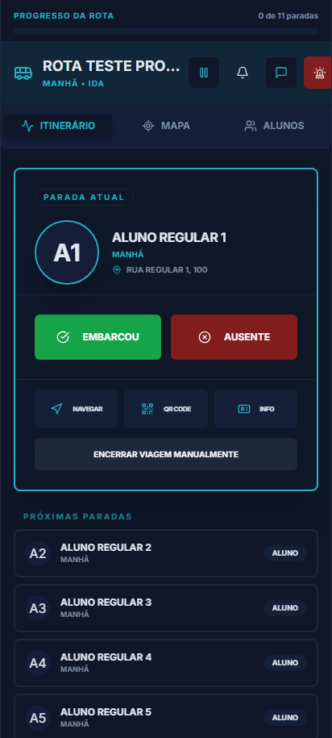

# Guardian - Manual do Usuário: Módulo do Motorista

Este manual orienta a equipe de motoristas sobre a operação diária no aplicativo Guardian em trânsito.

---

## 📸 Guia Visual da Tela Principal (Operação)

Abaixo está o mapeamento visual dos elementos da tela que você utilizará durante o trajeto:

1.  **Mapa do Trajeto (Topo)**: Exibe sua localização atualizada via GPS e a linha do trajeto otimizado até a próxima parada.
2.  **Lista de Passageiros (Meio)**: Relação de todos os alunos cadastrados no turno, ordenados por distância lógica.
3.  **Botão "Embarcar" (Verde)**: Clique assim que a criança subir na van. Isso avisa os pais imediatamente ("Seu filho embarcou às XX:XX").
4.  **Botão "Não foi" (Vermelho / X)**: Clique se o aluno não estiver no ponto ou se a família avisar que ele faltará.
5.  **Botão "Desembarcado"**: Clique ao entregar a criança na escola (Ida) ou na residência (Volta).
6.  **Botão "Reportar Incidente" (Ícone Alerta)**: Use para informar quebras, pneu furado ou trânsito lento em um clique.

---

## 🔑 1. Acesso e Login

O acesso ao aplicativo do Motorista é simplificado para facilitar o uso no celular:

1.  Abra a tela de login.
2.  Insira seu **CPF** no campo correspondente (ele será formatado automaticamente com pontos e traços).
3.  Insira seu **PIN de 4 a 6 dígitos** (senha numérica configurada pela empresa).
4.  Clique em **"Entrar no Sistema"**.

---

## 🚌 2. Início de Viagem e Seleção de Rota

Ao entrar, o motorista visualiza o painel operacional de rotas:

1.  **Escolha da Rota**: Selecione a rota correspondente ao seu veículo da lista exibida.
2.  **Escolha do Turno**: Escolha o turno correspondente (ex: Manhã ou Tarde).
3.  **Sentido da Viagem**: Marque se a viagem é de **Ida** (residência &rarr; escola) ou **Volta** (escola &rarr; residência).
4.  Clique em **"Iniciar Viagem"**. Isso notificará automaticamente os pais de que o trajeto começou e abrirá o compartilhamento de GPS.

---

## 📝 3. Lista de Paradas e Controle de Embarque

Com a rota iniciada, a tela principal exibe a listagem ordenada de todos os alunos associados a esse trajeto:

*   **Jornada de Ida**:
    *   A lista exibe a ordem exata de coleta nas residências.
    *   Ao parar em frente à residência do aluno, clique em **"Embarcou"** quando o aluno subir no veículo.
    *   Caso o aluno não esteja ou o pai avise que ele não irá, clique em **"Não foi"**. Isso altera o status de embarque e envia uma notificação aos pais e à central para que não esperem mais por esse aluno.
*   **Jornada de Volta**:
    *   Os alunos são coletados no pátio escolar. O monitor ou motorista marca a presença de embarque dos alunos.
    *   Ao entregar o aluno em seu destino (residência), clique em **"Desembarcou"** na lista.

---

## 📡 4. GPS e Telemetria Inteligente por Delta

A transmissão de localização do Guardian em produção foi desenvolvida sob regras rígidas de **FinOps e Conservação de Energia**:

*   **Rastreamento Delta**: O GPS não fica transmitindo sinal contínuo sem necessidade (o que superaquece o celular e consome 100% da franquia de dados móveis). O sinal é enviado em lotes apenas se houver movimentação física do veículo (deslocamento de distância ou alteração significativa de velocidade).
*   **Recomendação**: Mantenha o GPS do celular ativado e o aplicativo aberto em primeiro plano (ou com a tela ativa) no suporte do painel do veículo para garantir que a transmissão do trajeto seja precisa.

---

## 🚨 5. Envio de Incidentes em Tempo Real

Caso ocorra algum problema no trajeto, o motorista não deve perder tempo digitando textos longos:

1.  Clique no botão **"Reportar Incidente"** (ícone de aviso).
2.  Selecione uma das opções rápidas pré-configuradas:
    *   **Trânsito Lento**
    *   **Problema Mecânico (Pane)**
    *   **Pneu Furado**
    *   **Atraso Previsto**
3.  Ao clicar, a central administrativa recebe o alerta visual e os pais dos alunos na rota recebem um aviso proativo sobre a ocorrência e o impacto na viagem.

---

## 💬 6. Chat e Comunicação Operacional

*   O motorista pode acessar o menu **Mensagens** para visualizar mensagens de texto enviadas pelos pais ou pela administração.
*   *Nota de Segurança*: Não utilize o chat com o veículo em movimento. Dê preferência aos atalhos de alertas rápidos para comunicação imediata durante a rota.

---

## 🏁 7. Encerramento da Viagem

Ao realizar a última parada (seja na escola ou na última residência):

1.  Confirme no painel que todos os alunos embarcados receberam a marcação de desembarque.
2.  Clique em **"Encerrar Viagem"**.
3.  A transmissão de GPS será desligada e os pais receberão uma notificação final confirmando a chegada em segurança de todas as crianças na escola ou em casa.
