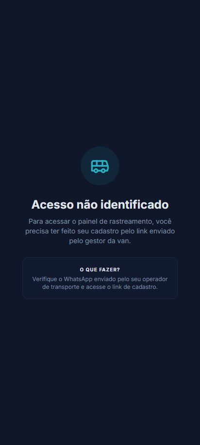

# Guardian - Manual do Responsável: Aplicativo dos Pais

Bem-vindo ao Guardian! Este guia orienta os pais e responsáveis sobre como utilizar todas as funcionalidades do aplicativo para acompanhar e gerenciar o transporte escolar do seu filho.

---

## 📸 Guia Visual da Tela Principal (Acompanhamento)

Abaixo está o mapeamento visual dos elementos da tela que você utilizará para monitorar a van:

1.  **Mapa ao Vivo (Topo)**: Exibe a rota traçada e o ícone do ônibus escolar deslocando-se em tempo real na tela.
2.  **Card de Status Físico (Entradas/Saídas)**: Sinaliza se o aluno está "Aguardando", "A bordo" ou se já "Desembarcou" com segurança.
3.  **Histórico Recente e Mural (Meio)**: Atalho para ler mensagens urgentes da administração ou do motorista.
4.  **Botão "Gerar QR Code"**: Abre o código digital do aluno usado para registrar presença no veículo no momento do embarque.
5.  **Smart Alert (Cerca Virtual)**: A notificação de proximidade aparece na tela automaticamente quando o veículo cruza o raio de 800m de sua residência.

---

## 🔑 1. Cadastro e Onboarding por OCR (IA)

O processo de criação de conta é ágil e simplificado por Inteligência Artificial:

1.  Baixe o aplicativo e clique em **"Cadastre-se"** (ou acesse `/signup`).
2.  Preencha as informações básicas (Nome, E-mail e Telefone).
3.  **Extração por OCR**: Tire uma foto nítida da frente e do verso do seu documento de identidade (RG ou CNH). A IA do Guardian (Gemini) processará a foto, extraindo os dados de CPF, RG e Endereço automaticamente para economizar tempo e evitar erros de digitação.
4.  Crie sua senha de acesso e clique em **"Concluir Cadastro"**.
5.  A administração receberá seus dados para validar e associar seu cadastro à rota escolar do seu filho.

---

## 📝 2. Assinatura do Contrato Digital

Após a aprovação do cadastro pela administração, você receberá o contrato de serviço:

1.  No menu do aplicativo, acesse a guia **"Contrato"** (`/parent/contract`).
2.  Revise as cláusulas personalizadas (modalidade de transporte, valor da mensalidade e dados da empresa).
3.  Clique em **"Aceitar Termos e Assinar"**. O contrato será assinado digitalmente e ficará arquivado no sistema para consulta e download em PDF a qualquer momento.

---

## 📍 3. Acompanhamento e Rastreamento ao Vivo

*   **Mapa em Tempo Real (`/parent/tracking`)**:
    *   Quando o veículo iniciar o trajeto (de ida ou de volta), um mapa aparecerá na tela do aplicativo mostrando a localização exata da van em movimento.
*   **Smart Alert (Alerta a 800 metros)**:
    *   Você receberá um aviso sonoro e visual em seu celular quando a van estiver a aproximadamente 800 metros de distância do seu ponto de embarque/desembarque. Isso evita esperas desnecessárias na calçada e atrasos da van.
*   **Mural de Avisos (`/parent/mural`)**:
    *   Acesse para ler comunicados importantes enviados pela gerência do transporte (ex: avisos de feriados, recessos ou comunicados urgentes).

---

## 💵 4. Portal Financeiro e Pagamento por Pix (`/parent/financial`)

Gerencie suas mensalidades sem sair do aplicativo:

*   **Visualização de Faturas**:
    *   Lista contendo todas as faturas pagas, pendentes ou vencidas do ano letivo.
*   **Pagamento Rápido via Pix**:
    *   Clique sobre a fatura pendente e selecione **"Pagar via Pix"**.
    *   O aplicativo gerará o código **Copia e Cola Pix** e o QR Code. Copie o código ou escaneie no aplicativo do seu banco para realizar o pagamento.
*   **Anexação de Comprovantes**:
    *   Caso faça o pagamento e queira acelerar a baixa na central, clique em **"Já paguei / Anexar comprovante"** e envie uma foto do comprovante bancário. A central administrativa revisará e confirmará a baixa do débito.

---

## 🛡️ 5. Segurança, QR Code e Terceiros Autorizados

*   **QR Code do Aluno (`/parent/qrcode`)**:
    *   Exiba o QR Code gerado no aplicativo para que o monitor o escaneie no embarque rápido da van. Isso registra o horário exato da entrada do seu filho no veículo.
*   **Terceiros Autorizados (`/parent/authorized`)**:
    *   Se você não puder buscar seu filho no ponto de desembarque, cadastre a pessoa autorizada:
        1. Acesse o menu **"Autorizados"**.
        2. Clique em **"Adicionar Autorizado"**.
        3. Insira o Nome Completo, RG e envie uma foto nítida do rosto da pessoa.
        4. O monitor usará essa foto para validar a identidade antes de liberar a criança no desembarque.

---

## 📅 6. Viagens Extras e Ausências

*   **Avisar Ausência**:
    *   Se seu filho não for à aula em determinado dia (por motivo de doença ou viagem), registre a ausência no aplicativo. Isso otimizará a rota da van no dia correspondente.
*   **Solicitar Viagem Extra (`/parent/requests`)**:
    *   Caso precise de um transporte pontual esporádico (ex: reposição de aula), envie um pedido detalhando a data e a escola. A central analisará a disponibilidade de frota, precificará a viagem e, se aprovada, a fatura Pix da viagem aparecerá na sua tela financeira.
